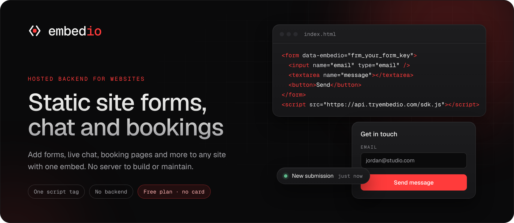
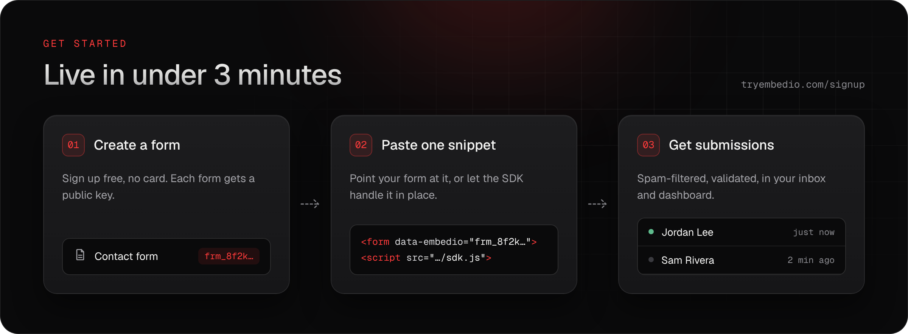
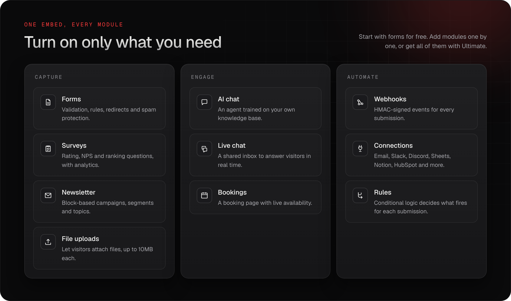
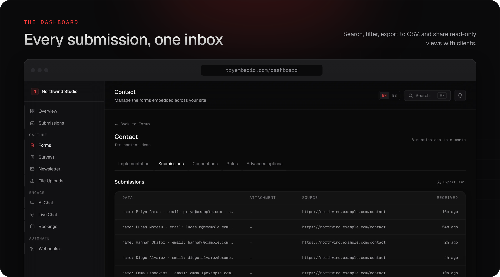

<a href="https://tryembedio.com">
  
</a>

<p align="center">
  <a href="https://tryembedio.com"></a>
  <a href="https://tryembedio.com/en/docs"></a>
  <a href="https://github.com/tryembedio/examples"></a>
  <a href="https://x.com/embedio"></a>
</p>

**embedio is a hosted backend for websites.** Point a form at it, or drop in one script, and your static, React or Next.js site gets forms, surveys, a newsletter, file uploads, AI chat, live chat and booking pages. Submissions land in one dashboard with spam filtering, validation and notifications handled for you. There's no server, API route or database to run.

<br>

<a href="https://tryembedio.com/en/signup">
  
</a>

### Plain HTML, no JavaScript

```html
<form action="https://api.tryembedio.com/f/frm_your_form_key" method="POST">
  <input name="email" type="email" required />
  <textarea name="message"></textarea>
  <input type="text" name="_gotcha" style="display:none" tabindex="-1" autocomplete="off" />
  <button>Send</button>
</form>
```

### Or let the SDK submit in place

```html
<form data-embedio="frm_your_form_key">
  <input name="email" type="email" required />
  <textarea name="message"></textarea>
  <button>Send</button>
  <p data-embedio-status role="status"></p>
</form>
<script src="https://api.tryembedio.com/sdk.js" defer></script>
```

Replace `frm_your_form_key` with your form's key from the dashboard. The key is public by design: it can only send to that one form. [Create a form free →](https://tryembedio.com/en/signup)

<br>

<a href="https://tryembedio.com/en/pricing">
  
</a>

<br>

<a href="https://tryembedio.com">
  
</a>

## Guides for your stack

| Stack | Guide | Working example |
| --- | --- | --- |
| Next.js | [Forms in Next.js](https://tryembedio.com/en/forms/nextjs) | [`examples/nextjs`](https://github.com/tryembedio/examples/tree/main/nextjs) |
| React | [Forms in React](https://tryembedio.com/en/forms/react) | [`examples/react`](https://github.com/tryembedio/examples/tree/main/react) |
| Astro | [Forms in Astro](https://tryembedio.com/en/forms/astro) | [`examples/astro`](https://github.com/tryembedio/examples/tree/main/astro) |
| Hugo | [Forms in Hugo](https://tryembedio.com/en/forms/hugo) | [`examples/hugo`](https://github.com/tryembedio/examples/tree/main/hugo) |
| GitHub Pages | [Forms on GitHub Pages](https://tryembedio.com/en/forms/github-pages) | [`examples/github-pages`](https://github.com/tryembedio/examples/tree/main/github-pages) |

Coming from another form backend? See the side-by-side comparisons with [Formspree](https://tryembedio.com/en/alternatives/formspree), [Formcarry](https://tryembedio.com/en/alternatives/formcarry), [Web3Forms](https://tryembedio.com/en/alternatives/web3forms) and [Netlify Forms](https://tryembedio.com/en/alternatives/netlify-forms).

## Pricing in one line

Start on the **Free** plan with no card, pay only for the modules you turn on with **Modular**, or get everything with **Ultimate**. One plan covers all your projects and teammates. [See pricing →](https://tryembedio.com/en/pricing)

<br>

<p align="center">
  <a href="https://tryembedio.com">Website</a> ·
  <a href="https://tryembedio.com/en/docs">Docs</a> ·
  <a href="https://tryembedio.com/en/docs/api-reference">API reference</a> ·
  <a href="https://tryembedio.com/en/changelog">Changelog</a> ·
  <a href="https://tryembedio.com/en/status">Status</a> ·
  <a href="https://x.com/embedio">X</a>
</p>

<p align="center"><sub>Not affiliated with EmbedIO (unosquare/embedio), the unrelated .NET web server library.</sub></p>
